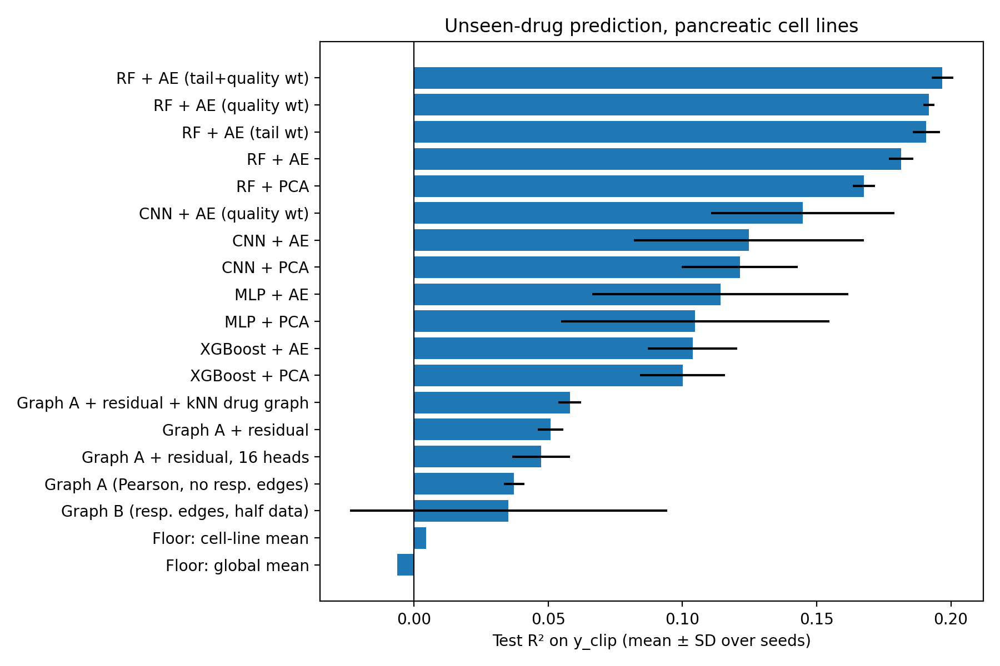
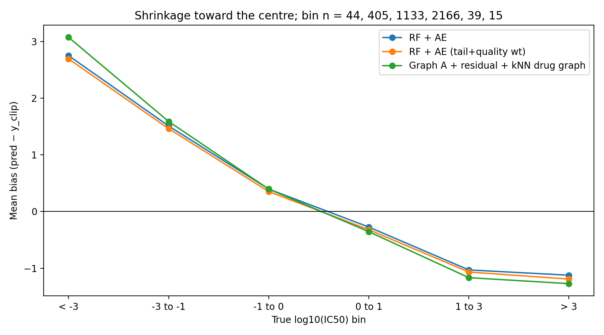

# Quality-Aware Assessment of Long-Tailed Drug-Response Prediction for Unseen Drugs in Pancreatic Cancer Cell Lines

A GraphTCDR-inspired study using PRISM. Preclinical cell-line prediction only; no clinical claims.

## Question

For drugs never seen in training, how well can drug fingerprints and multi-omics predict response in pancreatic cancer cell lines? Do a heterogeneous graph model and quality-aware / tail-aware training improve on simpler baselines?

## Data

- PRISM secondary repurposing screen, 28 pancreatic cell lines matched to GraphTCDR omics.
- 1,228 drugs and 18,037 cell-drug pairs (median of repeated measurements).
- Cell features: autoencoder (512-d, from expression, CNV, miRNA) or PCA (40-d).
- Drug features: RDKit Morgan fingerprint, 2,048 bits.
- Methylation is used only to build the cell-similarity graph.

## Evaluation Design

| Split | Pairs | Drugs |
|---|---:|---:|
| Train | 12,929 | 883 |
| Validation | 1,306 | 99 |
| Test (frozen) | 3,802 | 246 |

Cold-drug split: zero drug overlap (asserted in code). Validation is drug-grouped. The test set was never used for training, weighting, early stopping, or tuning.

## Target Policy

- Raw `log10(IC50)` has implausible extremes (about -110 to +288). 59 test pairs (1.5%) have `|y| > 3` and mostly poor curve fits.
- **Primary target `y_clip`:** clipped to training 1st/99th percentiles `[-3.2443, 1.2946]`.
- **Secondary target `y_raw`:** unclipped, reported separately.
- Bounds computed from training data only (`data/processed/target_v2/target_policy.json`).

## Results (`y_clip`, test, mean over 3 seeds)

| Model | R² | MAE | Spearman |
<<<<<<< HEAD

|---|---|---|---|
| RF + AE (LDS + quality weighted) | 0.204 | 0.529 | 0.413 |

| RF + AE (tail+quality weighted) | 0.197 | 0.525 | 0.418 |

| RF + AE (LDS weighted) | 0.194 | 0.529 | 0.400 |

| RF + AE (quality weighted) | 0.192 | 0.521 | 0.429 |

=======
|---|---:|---:|---:|
| RF + AE (tail+quality weighted) | 0.197 | 0.525 | 0.418 |
| RF + AE (quality weighted) | 0.192 | 0.521 | 0.429 |
>>>>>>> 9c55e4a5affbaafe3d9b4fb1ff656cdd2d66812d
| RF + AE | 0.182 | 0.521 | 0.420 |
| RF + PCA | 0.168 | 0.522 | 0.418 |
| CNN + AE (quality weighted) | 0.145 | 0.556 | 0.340 |
| CNN + AE | 0.125 | 0.553 | 0.343 |
| MLP + AE | 0.114 | 0.557 | 0.329 |
| XGBoost + AE | 0.104 | 0.563 | 0.290 |
| Graph A + residual + kNN drug graph | 0.058 | 0.574 | 0.259 |
| Graph A + residual | 0.051 | 0.580 | 0.234 |
| Graph B (response edges, half data) | 0.035 (SD 0.059) | 0.597 | 0.192 |
| Floor: cell-line mean | 0.005 | 0.598 | 0.123 |
| Floor: global mean | -0.006 | 0.604 | N/A |

Full tables:

- `results/v2/FINAL_headline_table_yclip.csv`
- `results/v2/FINAL_headline_table_yraw.csv`
- `results/v2/FINAL_all_scores.csv`

## Findings

1. Every model beats the constant-prediction floor on unseen drugs. Random Forest is best and most stable.
2. Reweighting (quality, tail, or both) gives a small gain in RF (approximately +0.01 to +0.015 R²) and in the CNN. Quality-only and tail-only effects cannot be separated.
3. The GraphTCDR-inspired model did not beat simpler baselines here. Adding the paper's residual connection, 16 heads, and a Tanimoto kNN drug graph moved it only slightly. Response edges did not help on average.
4. **Long tail:** all models shrink predictions toward the centre (overpredict the sensitive tail, underpredict the resistant tail). Weighting shifts error between bins rather than removing it. Models still enrich the most sensitive 10% of responses about 3-fold over chance (RF precision about 0.30 vs 0.10 random; graph about 0.20).
5. On `y_raw`, all models score R² near 0 (best 0.026) because 59 extreme labels dominate the error.

<<<<<<< HEAD
!\[Leaderboard](results/v2/fig\_leaderboard.png)

\## Findings

1\. Every model beats the constant-prediction floor on unseen drugs. Random Forest is best and most stable.

2\.Reweighting (quality, tail, LDS, or combinations) gives a small, consistent gain in RF (+0.01 to +0.02 R²) and in the CNN. The single-weight effects (quality-only, tail-only, LDS-only) cannot be separated from each other.

3\. The GraphTCDR-inspired model did not beat simpler baselines here. Adding the paper's residual connection, 16 heads, and a Tanimoto kNN drug graph moved it only slightly. Response edges did not help on average.

4\. Long tail: all models shrink predictions toward the centre (overpredict the sensitive tail, underpredict the resistant tail). Weighting shifts error between bins rather than removing it. Models still enrich the most sensitive 10% of responses about 3-fold over chance (RF precision about 0.30 vs 0.10 random; graph about 0.20).

5\. On `y\_raw`, all models score R² near 0 (best 0.026) because 59 extreme labels dominate the error.

6\. LDS-style reweighting (Yang et al., ICML 2021; label-distribution smoothing only, not the full method) combined with curve-fit quality gave the highest RF R² (0.204 vs 0.182 unweighted) and the lowest error on sensitive responses. It also raised error in the dense 0-to-1 bin and left ranking (Spearman about 0.41) and sensitive-tail enrichment (about 3x chance) unchanged. It redistributes error rather than solving the long tail.

!\[Bias by bin](results/v2/fig\_bias\_by\_bin.png)

7. Pan-cancer training (all 402 cell lines, 199,623 pairs, all validation and test drugs removed from every lineage) did not improve R² on pancreatic test pairs (0.167 vs 0.182) but slightly raised Spearman (0.442 vs 0.420). With the same 883 training drugs, this suggests drug-side information, not cell-line count, is the main limit. This is a hypothesis; more drugs were not tested.

\## Differences from the GraphTCDR paper
=======
## Differences from the GraphTCDR Paper
>>>>>>> 9c55e4a5affbaafe3d9b4fb1ff656cdd2d66812d

| Aspect | Paper | This project |
|---|---|---|
| Cell lines | 402 | 28 pancreatic |
| Drug fingerprint | PubChem 881-bit | RDKit Morgan 2,048-bit |
| Outliers | Removed (IQR) before splitting | Kept in test; training target clipped |
| Split | Random 8:1:1, 5-fold CV | Fixed cold-drug split |
| Target | Normalised IC50 | `log10(IC50)`, clipped (primary) and raw |

Scores are not comparable with the paper's. This is a GraphTCDR-inspired adaptation, not a reproduction.

## Limitations

- Only 28 cell lines; seeds capture model randomness only (fixed drug split, no split-uncertainty estimate).
- Extreme values treated as likely fit artefacts based on association with poor curve fit, not proven.
- Pairs without a finite IC50 (21,206 records) were excluded, likely biasing toward drugs that reached 50% inhibition.
- Autoencoder trained on 402 lines that may include the 28 (unsupervised, no response labels).
- Several paper baselines (DeepCDR, DeepTTA, GraphDRP, BANDRP, DRN-CDR) were not re-implemented.
- No external validation; preclinical only.

## Data Availability and Checkpoints

Raw source datasets are not included in this repository. The project uses the PRISM Repurposing 19Q3 Primary Screen and GraphTCDR-related data.

- **PRISM source:** [PRISM Repurposing 19Q3 Primary Screen](https://doi.org/10.6084/m9.figshare.9393293)
- **Processed files:** The target-v2 splits and target policy are provided under `data/processed/target_v2/`.
- **Model checkpoints:** Trained model checkpoints are not included in this repository.
- **Reproducibility:** See `requirements.txt` and the notebooks for the processing, training, and evaluation workflow.

Please consult the original data providers' terms and conditions for data access and redistribution requirements.

## Repository Structure

- `notebooks/`: 01–04 data preparation; 05 baselines; 06 tail diagnosis; 07 target policy; 08 autoencoder and graph preparation; 09 old graph notebook (superseded); 10 GraphTCDR v2; 11 final evaluation.
- `data/processed/target_v2/`: splits and target policy.
- `results/v2/`: predictions, tables, and figures.
- `requirements.txt`: package versions.

## Reproduce

Run notebooks in order. Use `11_Final_Evaluation.ipynb` for all reported numbers.

